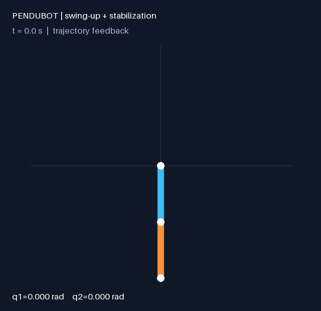

# Pendubot Optimal Control

Swing-up and stabilization of a two-link pendubot using **full differential dynamic programming (DDP)**, **iLQR**, and a local upright **LQR** controller. Includes a local browser interface with editable parameters, reproducible experiments, plots, animation, and a technical code walkthrough.



## Start on Windows

Install Python 3.12 or newer. Clone or download this repository, then:

1. Double-click **Install Pendubot.cmd** to create the local Python environment and install dependencies.
2. Double-click **Launch Pendubot.cmd** to start the interface.
3. Open **http://127.0.0.1:8765/** if the browser does not open automatically.

The first installation needs an internet connection. No GPU or account is needed to run the simulation locally. A changed model may require JAX to compile again before the optimization starts.

The Windows `.cmd` launchers now invoke Python directly. They do not require PowerShell scripts or a change to the Windows execution policy.

## Start from a terminal

Windows PowerShell:

```powershell
python -m venv .venv
.\.venv\Scripts\python.exe -m pip install -r requirements.txt
.\.venv\Scripts\python.exe interface.py --open
```

macOS or Linux:

```bash
python3 -m venv .venv
.venv/bin/python -m pip install -r requirements.txt
.venv/bin/python interface.py --open
```

The `.cmd` and `.ps1` launchers are Windows-specific; the Python interface can be started directly on other supported platforms.

## Editable parameters

Expand the sections in the left panel, edit a value, then click **Run simulation**. Use **Play**, the timeline, and the speed control to inspect the result.

| Section | Settings |
| --- | --- |
| Simulation | Full DDP, iLQR, or both; horizon; sample interval; holding duration; feedback or open loop; integration fidelity; initial torque guess; iteration budget |
| Robot | Link masses, link lengths, gravity; centres of mass and rod inertias update automatically |
| Cost weights | Diagonal running and terminal state weights, torque penalty, holding LQR torque weight |
| Disturbances | Initial execution angle and velocity offsets, velocity kick size and time |
| Solver tolerances | Relative cost reduction and feedforward correction tolerances |

Changes require a new optimization; playback controls only change how an existing result is viewed. Saved interface runs are written to `interface_runs/`, which is ignored by Git.

The dashboard also plots **objective value versus accepted optimizer iteration**. Switch between logarithmic and linear scales. **Compare both** overlays DDP and iLQR histories with their final objective values and step counts. The convergence chart updates after each completed run and remains separate from the motion playback timeline.

## Robot and control problem

- State: `x = [q1, q2, dq1, dq2]`.
- `q1` is measured from downward vertical; `q2` is the relative elbow angle.
- One motor acts at the base; the elbow is passive.
- Initial state: `[0, 0, 0, 0]`; target: `[pi, 0, 0, 0]`.
- Default links: uniform rods, 1 kg and 1 m each; gravity 9.81 m/s².
- Default plan: 6 s, 0.02 s sample interval, followed by 5 s of upright LQR.
- Dynamics are integrated with RK4. JAX differentiates the complete discrete map.
- Full DDP retains contractions of the value gradient with dynamics Hessians; iLQR omits those terms.

The model assumes rigid links, ideal joints, no friction, exact state feedback, and no hard motor torque limit. The terminal penalty is soft; success is evaluated separately from optimizer convergence.

## Run the batch experiments

```powershell
.\.venv\Scripts\python.exe run_simulation.py --output new_results
.\.venv\Scripts\python.exe -m unittest test_interface -v
```

On macOS/Linux replace the interpreter path with `.venv/bin/python`. The batch runner compares both methods from zero and sine initial guesses, verifies physics and derivatives, and evaluates open loop versus feedback with disturbances and finer integration.

## Included example results

The saved default benchmark converged to approximately **J = 5.175306** and **26.97 N·m** peak nominal torque. Both methods reached essentially the same objective; iLQR was faster in these particular trials. Trajectory feedback passed the specified arrival and holding tests. Open-loop execution was sensitive to integration differences and disturbances.

These are finite numerical experiments for the included settings, not a global convergence or hardware guarantee. Timing depends on the computer and compilation state.

- [Example report](results/report.html) — download and open locally for the full report.
- [Comparison data](results/comparison.csv)
- [Execution and disturbance data](results/execution_comparison.csv)
- [Complete saved settings and metrics](results/summary.json)

## Technical documentation and code map

- [Jupyter notebooks and opening instructions](notebooks/README.txt) — executable walkthroughs with explanations, equations, and saved outputs:
  1. [Robot dynamics and numerics](notebooks/01_Robot_Dynamics_and_Numerics.ipynb)
  2. [DDP and iLQR code walkthrough](notebooks/02_DDP_and_iLQR_Code_Walkthrough.ipynb)
  3. [Feedback, results, and dashboard](notebooks/03_Feedback_Results_and_Dashboard.ipynb)
- Install notebook support with `python -m pip install -r requirements-notebooks.txt`, then run `python -m jupyterlab notebooks` using your project environment.
- [Technical guide and Python explanation (PDF)](docs/Pendubot%20Technical%20Guide%20and%20Python%20Explanation.pdf)
- [Offline browser guide with copyable code](docs/Pendubot%20Technical%20Guide%20and%20Python%20Explanation.html)
- [10-slide Pendubot presentation](docs/Pendubot%20Presentation.pptx) — mechanics, dynamics, DDP, iLQR, upright LQR, convergence and disturbance results, with speaker notes.
- [Updated simulation dashboard screenshot](docs/images/pendubot-convergence-dashboard.jpg)
- [Equations and DDP recursion](DERIVATION.txt)

| File | Purpose |
| --- | --- |
| `pendubot.py` | Dynamics, RK4, derivatives, full DDP and iLQR solver |
| `run_simulation.py` | Physics checks, batch comparisons, upright LQR, plots, animation and report |
| `interface.py` | Local HTTP service, parameter validation, optimization jobs and execution |
| `launcher.py` | Direct Python installer and launcher; starts or reconnects to the local app |
| `interface.html`, `interface.js`, `interface.css` | Parameter controls, animation, charts and playback |
| `test_interface.py` | Regression checks for parameter handling and backward-pass compatibility |
| `test_launcher.py` | Checks startup, reconnecting, port conflicts and browser-opening failure |
| `requirements.txt` | Compatible dependency ranges |
| `requirements-lock.txt` | Exact versions used in the saved Windows Python 3.14 benchmark |

The PDF describes a source snapshot; line numbers may move after later edits. The original course assignment is referenced in the documentation and is not included in this repository.

## Generated files

The Python environment, runtime logs, caches, and personal interface runs are excluded by `.gitignore`. The small reference results in `results/` are included so the interface can show a verified example immediately after installation.
